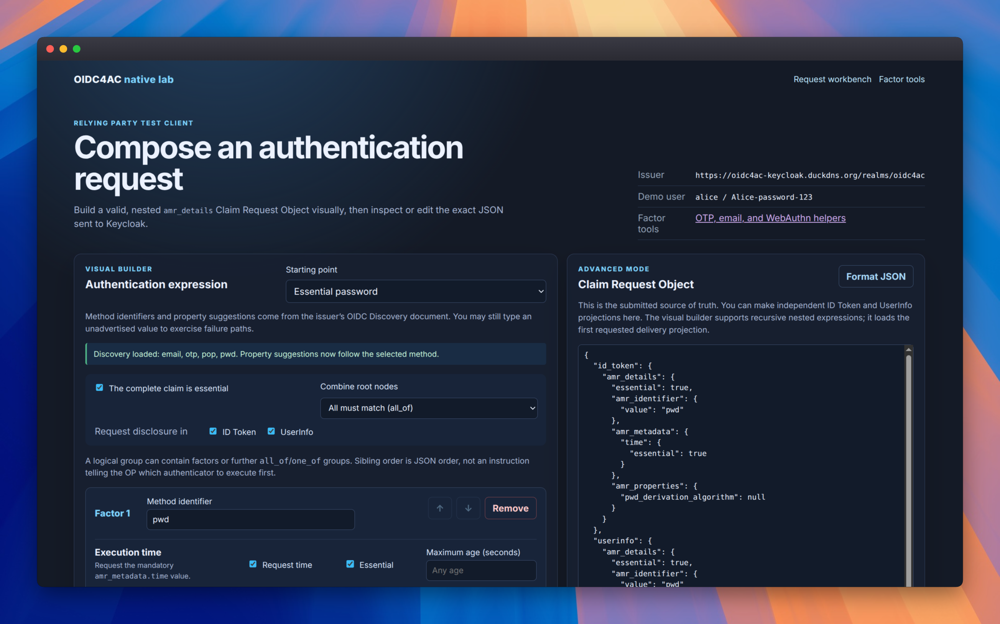

# Keycloak OIDC4AC Lab

A self-contained laboratory for trying OIDC4AC with a modified Keycloak server,
an interactive relying-party test client, an example authentication provider,
and automated HTTP/browser tests.

## What is OIDC4AC?

OpenID Connect identifies users, but offers limited detail about how they were
authenticated.
[OpenID Connect for Authentication Context (OIDC4AC)](https://bredstone.github.io/oidc4ac/)
extends OIDC so applications can request authentication requirements and receive
structured information about the methods actually used, when they ran, and
their properties. See the [protocol specification](https://bredstone.github.io/oidc4ac/)
for the normative reference and the [Keycloak guide](docs/keycloak-oidc4ac.md)
for the implementation overview.

This is a disposable research environment, not a production Keycloak
distribution or a protocol-conformance certification.

<p align="center">
  <a href="https://oidc4ac-client.duckdns.org">
    
  </a>
</p>

<p align="center">
  <a href="https://oidc4ac-client.duckdns.org">Test client</a> ·
  <a href="https://oidc4ac-keycloak.duckdns.org">Keycloak</a> ·
  <a href="https://oidc4ac-keycloak.duckdns.org/admin/oidc4ac/console/">Admin Console</a> ·
  <a href="https://oidc4ac-mail.duckdns.org">Email inbox</a> ·
  <a href="docs/hosted-instance.md">Usage guide</a>
</p>

The [public hosted instance guide](docs/hosted-instance.md) contains the
disposable credentials and a short walkthrough. For a reproducible local run,
continue with the installation instructions below.

## Implementation features

- Request individual factors or combine them with nested `all_of` (all required)
  and `one_of` (alternatives) expressions.
- Discover supported methods and properties, control disclosure, and inspect
  authentication context in ID Tokens and UserInfo.
- Try password, OTP, WebAuthn/passkey, and email-code flows in the
  [test client](docs/test-client.md).
- Connect your own authenticator and authentication-method-details SPI to the
  modified Keycloak server. The [example email provider](providers/oidc4ac-test-email/)
  demonstrates this extension point; follow the [custom SPI guide](docs/custom-authentication-spi.md)
  to implement your own method.

The modified server is maintained in
[Bredstone/keycloak-OIDC4AC](https://github.com/Bredstone/keycloak-OIDC4AC/tree/oidc4ac-implementation).
This lab pins its source to commit
[ec3fd9d](https://github.com/Bredstone/keycloak-OIDC4AC/commit/ec3fd9d3cedc7ad4b347256a0ab30116cb3b8fcc)
for repeatable builds.

## Documentation

Start with the installation below, then use the [test-client guide](docs/test-client.md)
and [usage examples](docs/usage-flows.md). The [documentation index](docs/README.md)
links all configuration, SPI, security, and troubleshooting guides.

## Repository structure

The repository contains the laboratory and the pinned Keycloak source as the
`keycloak-oidc4ac/` submodule. The companion repository listed above is the
source of that pinned submodule:

- `keycloak-oidc4ac/` — a Git submodule pinned to the Keycloak
  implementation commit (`ec3fd9d`) on the
  `oidc4ac-implementation` branch.
- `config/` — the disposable `oidc4ac` realm import.
- `test-client/` — the Flask relying-party workbench.
- `providers/oidc4ac-test-email/` — an example Keycloak authenticator and
  OIDC4AC details provider.
- `e2e/` and `tests/` — HTTP, browser, and feature-gate checks.
- `scripts/` and `dev.sh` — build, lifecycle, verification, and test
  automation.
- `docs/` — user and implementation documentation.

Generated Keycloak distributions, Maven caches, provider JARs, and test runtime
state are created under ignored `.build/`, `.runtime/`, and `target/`
directories. They are not required in the repository.

## Basic information

### Execution environment

The lab requires a Linux, macOS, or Windows host with:

- Docker Engine and Docker Compose v2;
- Git with submodule support;
- `curl`;
- internet access for Docker images and Maven dependencies;
- at least 4 CPU cores, 8 GB RAM, and 15 GB of free disk space; and
- a browser for the interactive test-client flow.

Java, Maven, Python, and Node.js are provided inside Docker build/test
environments and are not required on the host. The default services bind only to
localhost-compatible hostnames and ports. The regular client and end-to-end
profiles use Docker host networking so the loopback-only binding is preserved;
the Docker runtime must support host networking.

### Default services

| Service | Address | Purpose |
| --- | --- | --- |
| Keycloak | `http://keycloak.localhost:8080` | OIDC provider and Admin Console |
| Test client | `http://client.localhost:5000` | OIDC4AC relying-party workbench |
| smtp4dev | `http://localhost:5080` | Disposable email inbox |
| Browser profile | ports 8186/5003 | Isolated virtual-WebAuthn run |

The default test credentials are `alice / Alice-password-123` and
`admin / admin`. They are disposable credentials and must not be reused
outside this lab.

To inspect the local Keycloak configuration, open
<http://keycloak.localhost:8080/admin/> and sign in with `admin / admin`.
Select the `oidc4ac` realm, then open **Authentication → Flows**.

## Optional public hosted instance

Anyone can use the hosted instance to try the running implementation without
installing the lab. It is a convenience for interactive exploration; use the
repository and local commands for repeatable tests.

The hosted instance intentionally uses public, disposable credentials:

| Service | Username | Password |
| --- | --- | --- |
| Keycloak realm administrator (read-only) | `oidc4ac-demo-admin` | `O4AC-3500b25109a07bf339344f1c03f2e83b` |
| Test user | `alice` | `Alice-password-123` |
| Hosted smtp4dev inbox | none | none (public disposable inbox) |

These credentials are only for this disposable instance and must not be
reused. The administrator account is scoped to the `oidc4ac` realm and has
only the read-only `view-realm`, `view-identity-providers`, and `view-clients`
roles needed by the Admin Console to display the Authentication section. It
has no `manage-*` roles and cannot edit users, clients, or flows. The smtp4dev
inbox is intentionally public and contains only disposable messages.

To inspect the hosted configuration, open the [Keycloak Admin
Console](https://oidc4ac-keycloak.duckdns.org/admin/oidc4ac/console/), sign in
with the realm administrator credentials above, and open **Authentication →
Flows**. The URL selects the `oidc4ac` realm; it is not the private master-realm
bootstrap account.

## Dependencies

The main dependencies are:

| Dependency | Version or source |
| --- | --- |
| Keycloak implementation | `keycloak-oidc4ac` submodule at the pinned commit |
| Keycloak distribution | 26.7.0 |
| Maven builder | `maven:3.9-eclipse-temurin-21` pinned by digest in `dev.sh` and `scripts/lint.sh` |
| Python test/client images | `python:3.13.3-slim-bookworm` pinned by digest in their Dockerfiles |
| Email sink | `rnwood/smtp4dev:v3` pinned by digest in both Compose files |
| Browser test image | `mcr.microsoft.com/playwright/python:v1.60.0-noble` pinned by digest |
| Browser test | Chromium with a virtual CTAP2/WebAuthn authenticator |

The test client and end-to-end Python dependencies are declared in
`test-client/requirements.txt`, `e2e/http/requirements.txt`, and
`e2e/browser/requirements.txt`. The optional host lint dependencies are listed
in `requirements-dev.txt`.

## Security concerns

The lab intentionally starts a disposable development environment:

- the default Keycloak administrator password is `admin`;
- the realm contains test users, a test client secret, and a disposable OTP
  fixture;
- smtp4dev accepts and displays test email messages (the hosted inbox is public
  by design and must contain no real data);
- the Flask client uses a development secret unless overridden; and
- `./dev.sh run` stops this lab's Compose services by default.

Run the local lab only on an isolated local or disposable machine. Do not expose
the services to the public internet, do not reuse the credentials or OTP seed,
and use `./dev.sh run --no-kill` if other local containers must be preserved.
The implementation does not claim production hardening, hardware WebAuthn
coverage, or multi-node failover validation.

## Installation

Clone the repository with its pinned Keycloak source:

```bash
git clone --recurse-submodules https://github.com/Bredstone/Keycloak-OIDC4AC-Lab.git
cd Keycloak-OIDC4AC-Lab
```

The lab uses the pinned Keycloak submodule. If the submodule is
missing or not initialized, the helper falls back to a managed checkout of the
pinned commit `ec3fd9d3cedc7ad4b347256a0ab30116cb3b8fcc`. To use a different
local checkout, set `OIDC4AC_LAB_KEYCLOAK_REPO` before starting the build.

Start the complete laboratory:

```bash
./dev.sh run
```

The first run downloads Docker/Maven dependencies, builds the Keycloak
distribution in the managed `.runtime` checkout, compiles the example email provider,
imports the disposable realm, and starts the test client and smtp4dev. Expect
the first build to take several minutes and use several gigabytes of temporary
disk space.

For a non-interactive preparation:

```bash
./dev.sh build
./dev.sh provider-build
```

## Minimal test

After installation, run the smoke check:

```bash
./dev.sh verify
```

The command starts the local services and checks that Keycloak and the test
client respond, that the OIDC Discovery document is available, and that the
OIDC4AC capabilities are advertised.

For a manual functional check:

1. Open <http://client.localhost:5000>.
2. Keep the **Essential password** preset and start authorization.
3. Sign in as `alice` / `Alice-password-123`.
4. Confirm the result page contains `amr_details` with the `pwd` identifier and
   an execution timestamp.
5. Try the **Password and OTP (all_of)** preset and open the test client's
   **Factor tools** page to read/copy the current code from the OTP helper.



Stop the environment with:

```bash
./dev.sh down
```

## Automated tests

Run tests from the repository root after installation:

| Command | Coverage |
| --- | --- |
| `./dev.sh verify` | Service readiness and OIDC4AC Discovery |
| `./dev.sh test-http` | Requirements, disclosure, OTP/email, snapshots, and refresh |
| `./dev.sh test-browser` | Factor planning, WebAuthn/passkeys, alternatives, and cancellation |
| `./dev.sh provider-build` | Build the example custom provider |
| `./dev.sh test-disabled` | Ordinary OIDC with OIDC4AC disabled |
| `./dev.sh lint` | Python, shell, configuration, and provider formatting |
| `./dev.sh status` | Source checkout and local service status |

See [Testing and reproducibility](docs/testing.md) for expected results,
resources, dependencies, and coverage limits. The main build skips upstream
Keycloak unit tests; these commands exercise the lab's integration and quality
checks.

## Research and recognition

This project accompanies **OIDC4AC: Extending OpenID Connect for Structured and
Negotiable Authentication Contexts**. The evaluated version received all four
SBSeg 2026 artifact seals: **Available (SeloD)**, **Functional (SeloF)**,
**Sustainable (SeloS)**, and **Reproducible Experiments (SeloR)**.

## License

The laboratory code and documentation in this repository are distributed under
the Apache License 2.0; see [LICENSE](LICENSE). The
`keycloak-oidc4ac/` submodule retains the upstream Keycloak license and
notices in that source tree.
